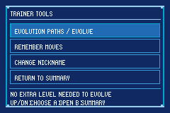
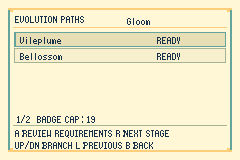
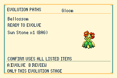
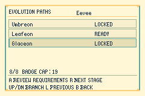
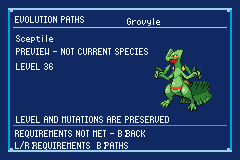

# QoL de evolución y herramientas del entrenador

Desde el **Resumen nativo**, START abre **TRAINER TOOLS**. Comparte geometría de 240 × 160 y controles en Eclipse y Daylight.

## Ramas y evolución manual

**EVOLUTION PATHS / EVOLVE** muestra las evoluciones inmediatas de la especie, sin duplicar destinos que admiten varios métodos. Arriba/abajo elige una rama; A abre sus requisitos. R permite explorar la siguiente etapa; L o B vuelve a la anterior. Las etapas futuras son de consulta: para evolucionar hay que seleccionar la especie que tiene actualmente el Pokémon.

La evolución manual permite activar una evolución por nivel ya alcanzado, incluso al tope por medallas, sin ganar otro nivel, experiencia ni consumir un Caramelo Raro. No cambia los topes de la partida. Solo puede aplicarse a un Pokémon del equipo del jugador fuera de combate; en las cajas se pueden consultar las líneas y sus requisitos.

| Método | Regla de la herramienta |
| --- | --- |
| Nivel | Exige haber alcanzado el nivel de la tabla y las condiciones adicionales. |
| Piedra u otro objeto de uso | Exige y consume una unidad de la mochila. |
| Intercambio simple | Usa y consume **Linking Cord**. No requiere conexión. |
| Intercambio con objeto específico | Usa y consume ese objeto desde la mochila o la ranura equipada. Prefiere la mochila para conservar el objeto equipado. No añade otra Linking Cord al coste. |
| Intercambio por especie | Linking Cord sustituye el intercambio y su pareja. |
| Amistad, horario, sexo, naturaleza, estadísticas, movimiento, lugar o progreso especial | Conserva las condiciones reales de la tabla del juego. La ficha muestra el requisito pendiente. |
| Giro o disparador de historia | Se puede consultar; exige realizar la acción original. |

Everstone y las restricciones nativas de factor Gigamax se conservan. Las ramas determinadas por la personalidad mantienen la rama natural del Pokémon. La evolución no edita naturaleza ni personalidad para habilitar otro destino.

**A en la ficha abre una segunda pantalla con todos los objetos que se van a consumir y su origen (BAG/HELD)**. B regresa sin gastar. A en esa confirmación revalida el Pokémon, la receta y el inventario antes del primer consumo. Las consultas y cancelaciones no generan RNG. Después de confirmar una evolución con coste no se puede detener su animación; una evolución sin coste conserva la cancelación nativa con B.

Se usa la escena de evolución del motor: conserva nivel, experiencia, mote, mutaciones y Gear, recalcula estadísticas y permite el aprendizaje nativo de movimientos de evolución. También conserva el registro de Pokédex y los efectos nativos de Nincada/Shedinja. Al terminar regresa a Trainer Tools y actualiza Resumen.

**Linking Cord** está siempre en **Horizon → ITEMS**, al precio normal del objeto. El catálogo mantiene ocho ofertas: cuatro suministros permanentes y cuatro artículos rotativos. El sorteo del mercado continúa siendo determinista y no consume el RNG global.

## Otros accesos QoL

- **MOVE MANAGER:** abre el [gestor de movimientos compatibles](TEAM_QOL.md), con nivel, preevolución, huevo, MT/MO y tutor/otros. Incluye revisión de costes, sustitución, reordenación y borrado seguro. B regresa a Trainer Tools; desde cajas se puede consultar el catálogo.
- **HELD ITEM / GEAR / IV / EV SIMULATOR:** permiten preparar las ranuras independientes y abrir el Simulador existente con sus requisitos y costes. Véase [Preparación del equipo](TEAM_QOL.md).
- **CHANGE NICKNAME:** abre el teclado nativo para Pokémon del entrenador original. Puede cambiar el mote de un Pokémon del equipo o una caja. El teclado mantiene su funcionamiento habitual: B borra, START selecciona OK y A confirma; confirmar un texto vacío conserva el mote previo.
- Los huevos, huevos defectuosos, contextos de combate/enlace y operaciones especiales del PC conservan sus restricciones. El cursor de un Pokémon sujeto en el PC no permite editar desde estas herramientas.

No se añade estado persistente al guardado. El plan de evolución y el historial de navegación son temporales.

## Validación

Las pruebas de `test/unholy_evolution.c` cubren el nivel alcanzado, las ramas de Gloom, la deduplicación de Kadabra, los costes de Onix desde mochila/equipado, cambios entre revisión y confirmación, consumo único, ausencia de RNG, amistad, Everstone, huevos y etapas futuras. `test/horizon_goods.c` verifica el suministro permanente y las propiedades del catálogo.

QA en mGBA a resolución nativa: evolución de Treecko al tope 19, selección y cancelación de Bellossom en Daylight, piedra correcta, Onix con Metal Coat en mochila y Leftovers equipado, regreso a Resumen y conservación de mutaciones/Gear/mote, aprendizaje de movimientos y teclado nativo. Las capturas de esta revisión están en `docs/images/evolution-qol-*`.

| Herramientas | Ramas | Confirmación |
| --- | --- | --- |
|  |  |  |

| Lista desplazable | Etapa futura |
| --- | --- |
|  |  |
