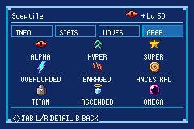
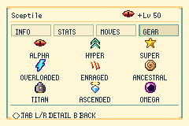

# Iconos de mutación · integración nativa

Se integran los nueve símbolos de los lotes de arte [#18](https://github.com/Techkron-star/pokemon-unholy-emerald/pull/18) y [#43](https://github.com/Techkron-star/pokemon-unholy-emerald/pull/43), importados desde `a897f2e107304515f7915612e8602f92d988b490`. Los PNG y las paletas originales permanecen intactos; el motor convierte sus colores al formato GBA habitual.

| Mutación | Símbolo |
| --- | --- |
| Alpha | Ojo rojo |
| Hyper | Doble flecha verde |
| Super | Estrella dorada |
| Overloaded | Rayo celeste con borde morado |
| Enraged | Tres zarpazos |
| Ancestral | Fósil en espiral |
| Titan | Fortaleza con núcleo dorado |
| Ascended | Gema azul y halo dorado |
| Omega | Eclipse magenta |

## Resumen

La cabecera muestra un símbolo y `+` si el Pokémon combina mutaciones. **GEAR → R** muestra todas las mutaciones presentes con sus nombres en una cuadrícula de 3×3. Los huevos no muestran información oculta. Se reserva la paleta del retrato por separado para evitar recolorear los símbolos.

| Eclipse | Daylight |
| --- | --- |
|  |  |

## Combate

Cada tarjeta tiene un símbolo de 16×16, separado del nombre, Gear y stamina. Cuando hay varias mutaciones, el símbolo alterna cada 90 fotogramas visibles y el nombre muestra `+`; Resumen permite consultar la combinación completa. Se utiliza la apariencia de Ilusión y se respeta el ocultamiento del fantasma sin Scope.

Los sprites siguen desplazamientos, visibilidad y prioridad del HUD. Se liberan antes de cargar animaciones y reaparecen después. Las paletas de los indicadores de gimmicks se cargan al necesitarlas, conservando los indicadores propios de Mega, Tera y reversión primigenia.

Los símbolos iguales comparten tiles y paleta. Si el selector de movimientos, un tipo, una habilidad o un Gear necesita el último banco disponible, tiene prioridad: el HUD cede una paleta de mutación y muestra una abreviatura (`A`, `H`, `S`, `OL`, `E`, `AN`, `T`, `AS`, `O`). El símbolo vuelve cuando queda espacio. La asignación de un icono opcional nunca desplaza otro icono para intentar obtener su propia paleta.

## Validación

- `python3 tools/unholy/validate_mutation_badges.py`: valida los nueve PNG 16×16, 4bpp, CRC, transparencia y coincidencia de paletas JASC, sin paquetes externos. Se ejecuta en CI.
- `test/unholy_mutation_icons.c`: comprueba enumeración de combinaciones, bits desconocidos, propiedad compartida y liberación de tiles/paletas. Forma parte de la suite de la ROM.
- Escenas preparadas en mGBA: nueve símbolos y nombres en Eclipse/Daylight, retrato con paleta independiente, regreso entre vistas, combinaciones y HUD doble con cuatro Gears. La escena también comprueba que dos instancias comparten recursos y que el banco se libera tras la última instancia.

La integración no cambia estadísticas, probabilidades, captura, flags de mutación ni formato del guardado. La vista de Resumen clásica usada para editar movimientos conserva sus textos. Quedan pendientes el recorrido de una partida natural y la comprobación en hardware.
