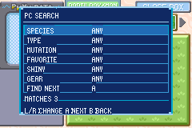
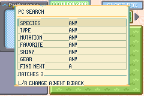

# PC: favoritos, protección y búsqueda

Continuación de la [interfaz nativa 240 × 160](UI_NATIVE_240.md). El PC conserva su organización, traslado múltiple y controles originales. La búsqueda utiliza los componentes comunes de Eclipse/Daylight.

## Favoritos y protección

En el menú de un Pokémon, **FAVORITE** activa la estrella que precede a su apodo; **UNFAVORITE** la retira. Un favorito no puede liberarse: el aviso pide retirar primero la marca. La protección también se comprueba al entrar en la confirmación y en la comprobación de liberación. No impide depositar, retirar, intercambiar posiciones ni equipar objetos o Gears.

La marca ocupa el bit anteriormente libre `BoxPokemon.isFavorite`, en el byte `0x13`, bit 7. No amplía `BoxPokemon`, no cambia los identificadores anteriores de `MON_DATA_*` ni necesita una extensión por identidad. Se copia con el Pokémon entre cajas y equipo y se guarda con sus datos habituales. Las cuatro marcas originales y `compressedStatus` conservan su posición. Los Pokémon nuevos comienzan sin favorito. Los huevos pueden marcarse; los Huevos Malos no se modifican desde este menú.

## Búsqueda

Seleccionar el título de la caja y **SEARCH**. START sigue llevando al título; SELECT conserva su función de acción rápida/selección múltiple. La búsqueda aparece en los modos de organización y retirada, con la bandeja del equipo cerrada y sin transportar Pokémon. No aparece al mover objetos ni durante una selección dirigida por un evento.

| Filtro | Valores |
| --- | --- |
| Especie | Cualquiera o la especie del Pokémon de la última casilla seleccionada en la caja actual; una casilla vacía o un huevo no proporciona especie |
| Tipo | Cualquiera o uno de los 18 tipos; coincide también el tipo secundario |
| Mutación | Cualquiera, sin mutaciones, cualquier mutación o una de las nueve insignias; una combinación coincide con cada insignia que contiene |
| Favorito | Cualquiera o solo favoritos |
| Shiny | Cualquiera o solo shiny |
| Gear | Cualquiera o con Gear equipado, independiente del objeto ordinario |

Arriba/abajo seleccionan la fila; izquierda/derecha o L/R cambian su valor. A avanza a la siguiente fila. En **FIND NEXT**, A cierra el panel y lleva el cursor a la siguiente coincidencia, cambiando de caja cuando haga falta. B cancela y devuelve el control al título de la caja. Los cambios cancelados se descartan; una búsqueda confirmada conserva sus filtros mientras permanezca abierta esta sesión del PC.

Los filtros se combinan con **AND** y el contador muestra las coincidencias en todas las cajas. La exploración comienza después de la última casilla seleccionada, recorre las cajas en orden y vuelve al principio; con una sola coincidencia puede regresar a la misma casilla. Cero coincidencias mantiene el panel abierto y emite el sonido de error. No ordena, mueve ni libera Pokémon. El equipo no forma parte de los resultados.

Las casillas vacías y los Huevos Malos quedan excluidos. Los huevos solo aparecen sin filtros que revelen su contenido: cualquier criterio de especie, tipo, mutación, shiny o Gear los excluye. El favorito no revela su especie y sí puede utilizarse para encontrarlos.

## Verificación

- `sh tools/unholy/host_pc_search.sh` compila el núcleo real y comprueba filtros combinados, los nueve bits de mutación, tipo secundario, privacidad de huevos, entradas vacías/inválidas, ausencia de cambios en los datos y recorrido circular de la máscara de coincidencias.
- `test/unholy_pc_favorites.c` comprueba en el motor que activar/desactivar el favorito solo cambia el bit reservado, preserva checksum, marcas, estado, objeto, Gear, mutaciones e identidad, y sobrevive a las copias caja/equipo. Se ejecuta con la suite de pruebas de la ROM.
- La CI comprueba la documentación, el núcleo de búsqueda y las compilaciones Emerald, FireRed, LeafGreen y release. Una compilación no acredita la revisión visual.

### Comprobación en emulador

En mGBA, mediante una escena preparada con Pokémon reales del motor, se comprobaron ambos temas, el menú de siete opciones, la protección de un favorito en una caja y transportado por el cursor, el contador con huevos, el caso de cero coincidencias, cancelación sin conservar cambios y salto a la última casilla de otra caja. La escena también verificó que activar la marca solo cambia el bit reservado y que la conversión caja/equipo conserva favorito y checksum. No sustituye un recorrido de juego ni las pruebas de guardado/carga.

| Eclipse | Daylight |
| --- | --- |
|  |  |

### QA manual pendiente

En Eclipse y Daylight, comprobar apodos largos, siete opciones en el menú, huevos, mutaciones combinadas y cajas llenas/vacías. Marcar un Pokémon del equipo, uno de una caja y uno transportado; intentar liberarlos y retirar luego la marca. Verificar conservar la estrella al guardar/cargar, depositar, retirar y trasladar múltiples Pokémon.

Buscar coincidencias en la misma caja y en otra, recorrer la última casilla y volver al principio, repetir con una única coincidencia y con cero. Cancelar tras cambiar filtros, reabrir SEARCH, volver desde Resumen y salir al menú de origen. Confirmar que ventana, paleta, cursor y flechas se restauran, y que las operaciones de objetos y la selección de eventos mantienen sus controles.
