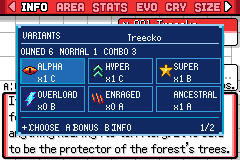
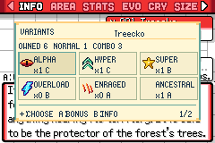
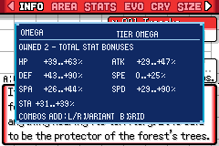
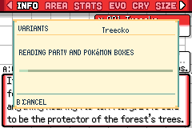

# Pokédex+: variantes de la colección

La ficha normal de Pokédex+ incorpora **A: VARIANTS**; SELECT también abre esa vista. Se mantiene la navegación HGSS por información, área, estadísticas, evoluciones, grito y tamaño. El retrato deja una línea para la nueva acción y el registro automático tras una captura conserva su flujo original.

## Colección por especie

El panel cuenta los ejemplares de la entrada seleccionada que están actualmente en equipo y cajas. Una cuadrícula muestra las nueve mutaciones en dos páginas, con su símbolo, cantidad y tier C/B/A/S/O (O identifica Omega). La cruceta recorre las variantes y el contador indica la página. La lectura se hace en lotes de hasta ocho slots ocupados, con barra de progreso y B para cancelar; los slots vacíos se omiten sin introducir retrasos por caja. B devuelve a la misma ficha.

- **OWNED** cuenta individuos, **NORMAL** los que no tienen mutaciones y **COMBO** los que reúnen varias mutaciones reconocidas.
- Un individuo combinado cuenta una sola vez en OWNED y COMBO, y aparece en cada mutación que contiene. La suma de las casillas no equivale al total de Pokémon.
- Se consulta la especie/forma exacta de la entrada. No se suman evoluciones ni especies de otras entradas.
- Huevos, Huevos Malos, slots vacíos y datos con checksum inválido quedan excluidos. Una especie vista pero nunca capturada no permite abrir la vista, siguiendo la restricción de datos de la ficha HGSS.
- Son datos de la **colección actual**, no un registro histórico de variantes encontradas. Liberar o intercambiar el último individuo puede dejar una casilla a cero. No se crean contadores persistentes ni se amplía el guardado.

| Eclipse | Daylight |
| --- | --- |
|  |  |

## Bonos de los ejemplares

A abre los bonos de la mutación seleccionada. L/R recorre las nueve variantes y B vuelve a la cuadrícula. Se muestran las seis estadísticas y stamina como porcentajes mínimo/máximo **observados en los ejemplares actuales**; con uno solo se muestra su valor. Si no hay ninguno, aparece un estado vacío.

Los valores proceden de `Pokemon_GetMutationStatBonusPercent` y `Pokemon_GetMutationStaminaBonusPercent`, con las mutaciones y personalidad de cada individuo. No se presenta un Omega fijo de +50 % ni un rango teórico. Los bonos son los totales de cada individuo: si un Alpha también es Hyper, sus bonos incluyen Hyper. `TOTAL STAT BONUSES` y `COMBOS ADD` distinguen esto de la contribución aislada de un único badge. Esta vista no describe efectos de EXP, movimientos ni otras reglas de combate.

## Integración y lectura

El panel utiliza el tema Eclipse/Daylight y los símbolos compartidos de mutación. Se abre sobre BG0 en los tiles 645–1008, reservados a las ventanas de grito/tamaño que están inactivas en Info. No sobrescribe los tiles de Info ni su huella. Al cerrar se restauran prioridad, coordenadas, tilemap, paletas y callbacks/visibilidad de los sprites originales. Los iconos propios se liberan. La tarea de entrada se pausa para evitar desplazamientos de especie o cierres simultáneos.

Las lecturas de Pokémon usan copias locales de los datos cifrados. Así, la validación de un checksum dañado tampoco marca el ejemplar original como Huevo Malo. Consultar no genera Pokémon, consume RNG ni altera equipo, cajas o datos de guardado.

## Verificación

- Cinco pruebas nativas en `test/pokedex_variants.c`: combinaciones y rangos con valores negativos, privacidad/entradas inválidas/bits desconocidos, correspondencia con los bonos reales sin cambios de Pokémon/RNG, y rechazo de checksum dañado sin marcar el original, y lectura por pasos reanudable sin cambiar el equipo/RNG.
- Emerald compila con `UNUSED_ERROR=1`; las cinco pruebas pasan en mGBA headless.
- Escenas preparadas en mGBA: recuentos de equipo/PC con normales y combinaciones, huevos excluidos, consulta de bonos y restauración de Info. La imagen de Info antes/después de cerrar el panel es idéntica píxel a píxel. También se recorren área, estadísticas y grito después de usar el panel.

Se comprueban Eclipse/Daylight, las nueve casillas, estados vacíos, especie vista sin capturar y cajas llenas. El caso completo contiene 420 ejemplares en PC más tres adultos del equipo (OWNED 423, NORMAL 1, COMBO 422); se comprueba cancelar durante la lectura y reabrir hasta obtener el resultado completo. Los huevos no se cuentan. Pendientes: recorrido de partida natural, todas las formas y hardware.
