# Pokélocator: catálogo, obtención y búsqueda

El localizador usa las tablas y las reglas de Unholy. Elite Redux sirve de referencia funcional; la interfaz, los desbloqueos y la Señal mutante pertenecen a Unholy. No habilita rastreo, proximidad, estrellas ni niveles de búsqueda heredados del motor.

## Catálogo y controles

- Seis iconos por página, especies únicas por categoría, incluidas las no vistas. La ficha lateral muestra nombre, número nacional, tipos, habilidades ordinarias y habilidad oculta de la especie; no predice las habilidades o mutaciones del ejemplar que se generará. Los nombres completos se consultan en **Species Profile**.
- **L/R:** solo categorías presentes y desbloqueadas. Hierba/cueva, agua, pesca, Golpe Roca y ocultos tienen grupos separados. Las cañas mantienen sus propios slots y requisitos. Miel y Headbutt no tienen tablas en esta rama: no se inventan encuentros ni pestañas vacías.
- El contador **CAUGHT x/y** y **COMPLETE** cuentan especies únicas de la categoría. La marca inferior de cada icono indica capturado.
- **Cruceta:** seleccionar. **A:** Search / Obtain One / Register Target for R / Species Profile. **SELECT:** obtener todos o solo nuevos **de la categoría seleccionada**. **B:** cancelar o regresar al origen.
- **START → Tools:** otros pisos de la zona, Señal mutante y filtro ALL/MISSING/CAUGHT. Consultar otro piso no permite obtener ni buscar allí. El filtro de colección no reduce silenciosamente el alcance de ALL o NEW.
- Las estadísticas completas, movimientos, evoluciones y edición se mantienen en Pokédex/Resumen.

## Obtención gratuita

**Obtain One**, **Obtain All** y **Obtain Only New** preparan una revisión antes de entregar. ALL incluye especies ya capturadas; NEW usa el registro de capturados, no la posesión actual. Se deduplican especies presentes en varias cañas.

La revisión muestra cantidad, nivel, destino equipo/PC y espacio libre. **B no genera Pokémon, consume RNG ni cambia el registro.** Antes de confirmar se comprueba espacio para todo el lote. Se revalidan mapa, horario, categoría, desbloqueos, especies, registro y nivel confirmado; si cambiaron se exige revisar de nuevo. Una entrega nativa inesperadamente fallida informa la cantidad realmente entregada.

Se usa `ScriptGiveMon` y la entrega nativa al equipo y luego al PC, con sus reglas de origen especial, mutaciones y registro en Pokédex. No cuesta Balls, dinero ni puntos. No consume cargas de Señal, que se aplican a encuentros salvajes. El resultado informa cantidades entregadas al equipo y al PC y refresca el progreso.

## Topes por medallas para toda la partida

Por decisión del usuario, los topes nativos están activos globalmente, tanto en EXP de combate como en caramelos y entregas del localizador:

| Progreso | Nivel máximo |
| --- | --- |
| Sin medallas | 15 |
| 1 / 2 / 3 / 4 medallas | 19 / 24 / 29 / 31 |
| 5 / 6 / 7 / 8 medallas | 33 / 42 / 46 / 58 |
| Campeón | 100 |

Una recompensa grande de EXP se recorta al límite. Los Pokémon de partidas existentes que ya lo superen conservan nivel y EXP; no ganan más hasta que el progreso lo permita. Los caramelos no pueden elevarlos ni reducirlos. No cambian los topes de EV.

## Búsqueda dirigida y R

**Search** revisa método, niveles salvajes, Balls, capacidad y cargas de Señal. **B** cancela sin efectos; **A** revalida y crea un combate salvaje normal. La captura en combate usa una Ball. La búsqueda guarda el objetivo para **R**, también disponible mediante **Register Target for R**. En el campo, estando quieto, R repite especie y método contra la tabla del mapa actual; si falta allí, muestra el motivo y no genera un ejemplar alternativo.

El objetivo se guarda en una variable de eventos reservada, con marcador de formato y validación de especie/método. Emerald usa el antiguo `VAR_ROUTE102_STATE`, sin consumidores de historia; FRLG usa `VAR_0x40F2`. No se amplía ni mueve el SaveBlock. La navegación recuerda su selección durante la sesión; el objetivo R sobrevive a guardar/cargar.

| Método | Desbloqueo del catálogo | Condiciones adicionales para Search |
| --- | --- | --- |
| Hierba/cueva | Tabla presente | Pokémon sano y terreno con encuentros terrestres |
| Agua | Surf desbloqueado | Estar surfeando o bajo el agua |
| Pesca | Poseer la caña correspondiente | Posición nativa válida para pescar |
| Golpe Roca | Movimiento de campo desbloqueado | Un miembro del equipo lo conoce y estar en tierra |
| Ocultos | Campeón y entrenadores normales del mapa derrotados | Tierra/agua según la tabla |

Tras desbloquear ocultos se muestran también las especies no vistas. Los entrenadores exigidos se obtienen de los eventos nativos del mapa, no de IDs importados de Elite Redux. Obtener directamente no exige estar en hierba, surfear ni tener un equipo sano; sí respeta el mapa y los desbloqueos.

Safari, Pirámide, batalla en curso, bloqueos de encuentros/captura e impedimentos de historia bloquean obtención y búsqueda. Esta rama no contiene un modo de captura única por ruta; no se inventa una restricción de ese tipo. Search respeta pesos por slot/caña y `ChooseWildMonLevel`; no une rangos para inventar niveles intermedios.

## Señal y presentación

**Tools → Mutant Signal** conserva las nueve mutaciones, tiradas base `1/N`, cargas y confirmación del servicio existente: HF Watch, medallas/reloj, una activación diaria y diez encuentros del mapa. La mejora C/B es relativa; A/S/Omega mantienen sus tasas. Consultar nunca consume cargas; Search confirmado usa el generador nativo y consume una.

Eclipse y Daylight comparten geometría 240×160. Los textos reservan 12 píxeles reales por línea; catálogo y modales usan tiles por debajo del límite de 512 del bloque del campo y liberan iconos/paletas al regresar.

## Verificación

`test/pokelocator.c` cubre tablas, slots, cañas, deduplicación, filtros y navegación. `test/pokelocator_plus.c` cubre los nueve hitos de nivel, caramelos, objetivo R inválido, grupos separados, revisión sin RNG, entrega al equipo/PC, ALL/NEW y cajas llenas. `test/battle/level_caps.c` comprueba recompensas grandes al borde del tope y Pokémon que ya lo superan. Las pruebas de fórmulas de EXP declaran progreso de Campeón para no confundirse con los límites de historia.

QA en mGBA (Eclipse y Daylight): catálogo, revisión/entrega individual, lote NEW, cancelación, registro R y combate nativo, regreso al campo, PP separado de stamina, combate doble sin cadena según sus reglas existentes, Resumen sin mutaciones y con las nueve, mochila de diez categorías y selector desplazable/reabierto. Se conservan capturas nativas de 240×160 en `docs/images/locator-plus-*`.

Pendiente: recorrido natural completo de la historia, todos los mapas/horarios, todos los métodos y hardware real.

Referencia: [DexNav+ de Elite Redux, rama upcoming](https://github.com/Elite-Redux/eliteredux-source/blob/upcoming/src/dexnav.c). No se importa código ni arte de esa referencia.

## Capturas nativas

| Eclipse | Daylight |
| --- | --- |
| 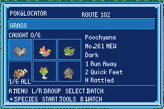 | 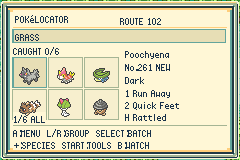 |
| 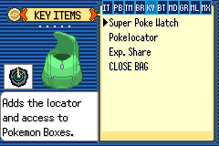 | 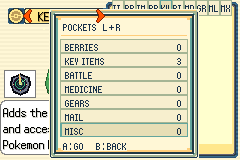 |
| 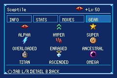 | 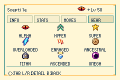 |

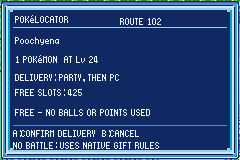 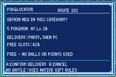

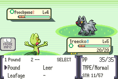 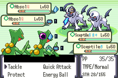

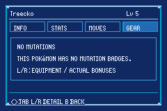
