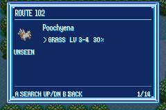
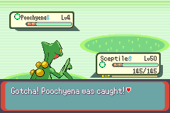

# Pokélocator: buscar, combatir y capturar

La versión de consulta solo abría la información al pulsar A. Ahora la ficha permite iniciar un encuentro salvaje con la especie elegida, usando el motor normal de combate y captura.

## Controles

1. Abrir **WATCH → LOCATOR** o usar el objeto clave.
2. Elegir una especie y pulsar **A** para ver su ficha.
3. Pulsar **A: SEARCH** para buscarla en el mapa actual e iniciar el combate.
4. Usar una Poké Ball desde la Mochila durante el combate. Se aplican las reglas habituales de captura; Buscar no captura automáticamente.

**B** vuelve a la lista y después al menú de origen. **L/R** filtra los métodos y **←/→** permite consultar otros pisos/mapas de la misma zona. Esos mapas se pueden consultar, pero hay que desplazarse allí para buscarlos: el localizador no crea encuentros remotos.

La ficha marca con `>` el método de la fila elegida. Si falta algún requisito, el pie explica el motivo y A no cierra la ventana ni genera el Pokémon.

| Buscar desde la ficha | Captura en combate |
| --- | --- |
|  |  |

## Requisitos y datos

| Método | Requisito para Buscar |
| --- | --- |
| Hierba/cueva | Estar en tierra y tener un Pokémon apto para combatir |
| Surf | Estar surfeando o bajo el agua |
| Cañas | Poseer la caña de esa fila y estar en una posición donde el motor permite pescar |
| Golpe Roca | Tener desbloqueado el movimiento de campo y un miembro del equipo que lo conozca |
| Ocultos | Haber visto la especie; se aplica además el requisito de tierra/agua de su tabla |

Se vuelve a comprobar el mapa, horario y disponibilidad al confirmar y después de cerrar la ventana. Se elige un slot de la especie respetando los pesos de su método/caña; el nivel se obtiene con `ChooseWildMonLevel`. No se inventan niveles intermedios a partir de la unión de varios slots. Una solicitud inválida no consume RNG ni modifica el equipo enemigo.

Buscar evita la tirada de aparición al caminar y el repelente, como una acción manual. El combate es individual y salvaje, permite capturar y devuelve al campo al terminar. Usa la generación habitual de movimientos, IV, naturaleza y mutaciones; respeta la Frecuencia del WATCH si ya estaba activada. No activa el modificador de mutaciones pendiente de diseño ni añade costes propios.

Safari, Pirámide de Batalla y bloqueos de encuentros/captura impiden Buscar. La ventana restaura su paleta y libera iconos al pasar al combate. Sus tiles quedan antes del marco estándar para evitar que el texto sobrescriba los bordes.

## Verificación

- Cuatro pruebas añadidas a `test/pokelocator.c`: pesos y slots con niveles separados, separación por caña, tablas ocultas/entradas inválidas y rechazo sin cambiar RNG ni Pokémon enemigo.
- Compilación Emerald y comprobación en mGBA con una escena de campo real preparada en Ruta 102.
- Verificado en mGBA: ficha → combate salvaje → Mochila → Master Ball → Pokédex → rechazar mote → campo. Poochyena queda como segundo miembro del equipo; la cantidad de Master Balls pasa de 10 a 9, el resultado es `B_OUTCOME_CAUGHT` y el estado Pokédex es `CAUGHT`. El control queda desbloqueado, se puede caminar y al reabrir el localizador la especie aparece capturada. No se simula la captura desde el localizador.

Pendientes de QA: recorrido de una partida natural, todos los mapas y métodos, captura con equipo y cajas llenos, y hardware.
