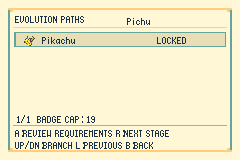
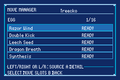
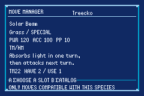
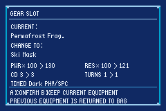
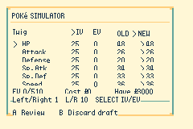
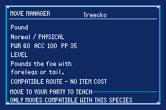

# Preparación del equipo y gestor de movimientos

Continuación de [Evolución y herramientas QoL](EVOLUTION_QOL.md). **Resumen → START** abre una lista desplazable de siete herramientas, con contador: evolución, movimientos, objeto, Gear, Simulador, mote y regreso. Eclipse y Daylight comparten datos y navegación en 240 × 160.

## Movimientos compatibles

**MOVE MANAGER** se abre desde Resumen o **Horizon → MOVES → RELEARN**, después de elegir un Pokémon. Izquierda/derecha o L/R cambia de categoría; arriba/abajo recorre la lista; A abre la ficha. Cada movimiento aparece una vez en ALL, aunque tenga varios orígenes.

| Categoría | Catálogo y disponibilidad |
| --- | --- |
| ALL MOVES | Unión de todos los orígenes compatibles; muestra READY, KNOWN, LEVEL o NEED DISC. |
| LEVEL | Tabla de la especie actual. Los niveles futuros se pueden consultar; aprenderlos exige alcanzar el nivel o disponer de otra vía válida. |
| PRE-EVO | Movimientos de nivel de las preevoluciones, respetando el nivel actual. |
| EGG | Movimientos de huevo de la línea ancestral, compatibles con sus tablas. Se enseñan gratuitamente sin tener que criar otro Pokémon. |
| TM / HM | Discos compatibles con la especie actual. La ruta por disco exige tenerlo en la mochila; solo consume una unidad cuando las reglas del objeto lo requieren. MO, objetos importantes y MT reutilizables se conservan. |
| TUTOR / OTHER | Tutores y otros movimientos del conjunto enseñable de la especie. Se enseñan gratuitamente desde este servicio. |

Los orígenes son acumulativos. Un movimiento que también existe por huevo o tutor puede aprenderse por esa vía gratuita aunque figure en la categoría de MT. La ficha muestra los orígenes disponibles y el coste efectivo. No se ofrecen movimientos ajenos a las tablas compatibles de la especie/línea.

La ficha muestra nombre, tipo, categoría, potencia, precisión, PP, descripción y requisito. A elige una de las cuatro ranuras; otra confirmación muestra la sustitución y el coste. B cancela sin aprender ni consumir. Antes de aplicar se vuelven a comprobar identidad del Pokémon, compatibilidad, ranura e inventario. La sustitución conserva los bloqueos nativos de movimientos de campo; el nuevo movimiento comienza con sus PP base y sin PP Ups de la ranura anterior.

En el catálogo, **SELECT** abre las ranuras actuales. A marca una y A sobre otra las intercambia, conservando PP y PP Ups con cada movimiento. START abre la confirmación de borrado. No se puede borrar una ranura vacía ni el último movimiento conocido; el borrado usa las reglas del eliminador y compacta las ranuras.

El catálogo conserva los movimientos ya conocidos y explica las categorías vacías. En cajas y otros contextos de consulta se puede revisar la ficha, pero editar exige llevar el Pokémon al equipo del jugador. Los huevos y Huevos Malos no exponen un catálogo.

Este gestor utiliza un catálogo acotado por `MOVES_COUNT`; no reutiliza el buffer de 60 movimientos del recordador antiguo. Los NPC y scripts que usan el recordador original conservan su funcionamiento. Los desbloqueos globales de ese recordador no se modifican: huevo y tutor son capacidades del nuevo servicio de preparación.

## Evolución con progreso

La lista incorpora iconos compactos de cada destino. La revisión muestra nivel actual/requerido, amistad, objetos disponibles, pasos del Pokémon líder, usos de movimientos, daño, victorias o críticos según la condición real de la tabla. También identifica si el horario requerido es el actual. Los valores no se inventan ni se reinician al consultar la ficha.

Las etapas futuras siguen siendo de consulta. Se mantienen las reglas de piedras, Linking Cord, objetos específicos, amistad, horario, personalidad y progreso descritas en [Evolución QoL](EVOLUTION_QOL.md).

## Objeto, Gear y Simulador

**HELD ITEM** y **GEAR** abren listas independientes de lo disponible en la mochila, con cantidades y opción explícita de devolver el equipo actual. A abre una comparación y una segunda A confirma. El Gear compara potencia de sobrecarga, potencia residual, recarga y duración; indica la activación y los tipos/categorías compatibles del nuevo Gear. El objeto muestra su descripción nativa. El intercambio devuelve el anterior a la mochila y se rechaza si no hay espacio; cancelar o revisar no mueve objetos.

Los objetos clave, Gear y correo no se tratan como objetos equipables ordinarios. El correo conserva su flujo de mochila/PC. El Gear reutiliza `Gear_TryEquipFromBag`; no ocupa la ranura de objeto ni se duplica al cambiarlo. La lista se prepara al entrar o después de aplicar, y la operación revalida el inventario al confirmar.

**IV / EV SIMULATOR** abre el servicio existente con el Pokémon seleccionado. Conserva el requisito de **HF Poké Watch y cuatro medallas**, límites legales, coste, revisión antes de pagar y bloqueo de genética de Ascendido/Omega. Al salir vuelve a Trainer Tools.

## Guardado y diseño reciente

No cambia el esquema de guardado. Las listas, borradores y planes son temporales. Se revisaron `f2d136934` (evolución QoL), `a727778a0` (HUD de mutación/Gear), `dacbfdc91` (aislamiento de pruebas del localizador) y `234c088fa` de `master` (mochilas evolutivas y cantidades `u32`). Esta última especificación sigue pendiente de implementación: este lote usa las operaciones vigentes del inventario y presenta cantidades con espacio para cinco dígitos, sin introducir tiers ni ampliar límites globales.

## Validación

- Doce pruebas nuevas: siete de movimientos, cuatro de equipo y una de progreso evolutivo. Cubren compatibilidad, deduplicación, ausencia de RNG, preevolución/huevo/tutor, MT disponible y ausente, consumo único, datos obsoletos, PP/PP Ups, último movimiento, huevos, listas acotadas, catálogo de Mew superior a 60 entradas, separación objeto/Gear y cantidades/requisitos.
- Suite focalizada: **34 PASS y 9 fallos esperados del verificador**. Compilación Emerald con advertencias como errores, índice documental y comprobaciones nativas de guardado, PC e iconos.
- mGBA: huevo aprendido/cancelado, Solar Beam mediante TM22 y consumo de una unidad, tutor, cuatro ranuras, reordenación/borrado, consulta desde cajas, categorías vacías, Horizon → selección → gestor → mapa, objeto y Gear separados, comparación de Gear, progreso de Pichu, iconos de evolución, Simulador bloqueado/desbloqueado y retorno. Ambos temas a resolución nativa.

| Evolución | Huevo | MT |
| --- | --- | --- |
|  |  |  |

| Gear | Simulador | PC de consulta |
| --- | --- | --- |
|  |  |  |
